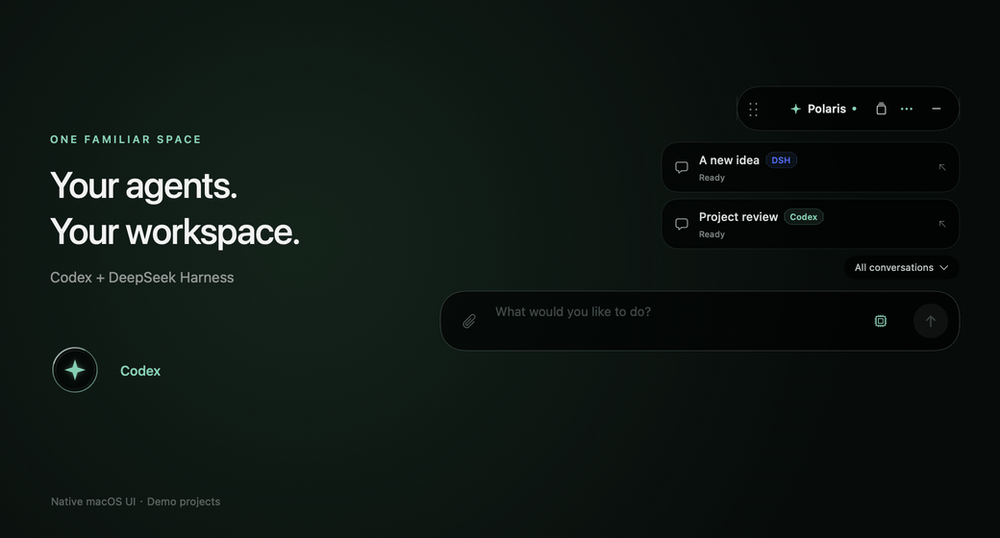

<p align="center">
  
</p>

<h1 align="center">POLARIS</h1>

<p align="center"><strong>A space for your agents.</strong></p>

<p align="center">A native macOS workspace for Codex and DeepSeek Harness.</p>

<p align="center">
  <a href="https://github.com/Arika1415/Polaris-Releases/releases/download/v1.16.0/Polaris-1.16.0-101-arm64-release.dmg"></a>
</p>

<p align="center">
  <a href="#installation">Installation / 安装说明</a> ·
  <a href="https://github.com/Arika1415/Polaris-Releases/releases">Release notes</a>
</p>

<p align="center"><sub>Apple Silicon preview · Requires a configured local Codex or DeepSeek Harness.</sub></p>

<p align="center">
  
</p>

<p align="center"><sub>Native macOS UI with demo projects. Agent capabilities vary; see the release notes.</sub></p>

<p align="center"><strong>One-click access</strong> · <strong>Session management</strong> · <strong>Visible task progress</strong></p>

**1.16.0 preview:** Adds chat image thumbnails and click-to-enlarge previews, including supported Agent-generated images and Codex image history. Handoffs can now deliver explicitly reviewed result files to an isolated receiving directory, verify their contents, and recheck them before takeover. Existing native input, independent Codex/DSH tasks, project rules, bilingual UI and orb interactions are retained.

**1.16.0（101）预览版：**包含此前未公开的1.15.0成果文件交付和1.16.0聊天图片更新。

- **聊天图片：**输入区和消息内显示图片缩略图，点击放大，支持缩放及Esc关闭；沿用Polaris深色圆角、半透明面板和Agent主题色。图片在后台读取和降采样，不替换原生输入框。
- **生成结果与历史：**接收Codex支持的图片生成结果，保存到本机并恢复图片历史；Agent最终回复中的明确本地Markdown图片引用也会显示。图片生成依赖所选Agent的工具和账号能力；DSH附件发送仍有原有限制。无法读取的图片显示不可用，不自动联网加载外部图片，也不重发生成任务。
- **成果文件接棒：**程序先汇集对话与文件元数据供独立无工具总结，用户审阅成果文件清单后，程序复制并校验，再创建接收会话。新项目使用独立目录，已有项目收到独立子目录，不覆盖其原文件。
- **确认之后归档：**送达交接包、复制文件或得到AI总结都不等于接管完成。接收方核对现状，用户确认时再校验文件，通过后继续任务并归档来源；失败保留原项目，不自动重复发送。
- **保留现有交互：**悬浮球边缘停留约0.55秒后边条快速闪烁，松手贴边；悬停只高亮放大，点击恢复球体，再次点击打开面板。独立Agent任务、模型切换、规则管理、项目归档及中英切换继续保留。

交接总结不是文件事实，接收方仍需核对现状；接收任务遵守原生Agent权限，文件引用不是读取沙箱。归档不等于完整目录备份。全局／项目规则、独立项目目录与安全缓存清理继续保留。

发布包采用与维护本机相同的功能源码和运行资源。发布后会回下载DMG、校验SHA-256，并对镜像内应用与本机安装进行逐文件比对；验收记录见本版Release。安装包不包含开发者账号、项目、聊天历史或已授权的系统权限，使用者仍需配置自己的Agent环境。

**数据路径：** `~/Library/Application Support/Polaris/`；更新缓存为 `~/Library/Caches/Polaris/UpdateDownloads/`。旧用户正常退出并启动新版后自动迁移，旧 `CodexTaskPanel` 路径仅保留兼容链接。不会覆盖冲突目录、删除历史或归档文件。

规则入口：主面板 `… → 规则管理…`；项目卡片右键“项目规则…”。只有明确确认保存的内容才会生效，后续发送和补充使用新版本，不重启任务。原生Agent有效规则继续适用；这不是文件读取沙箱或自动权限授予系统。

## Place it where you work

Drag the floating orb to a comfortable position. Release it to dock at a side or near the top center, with a subtle destination hint and a gentle settling motion. The close-up follows the orb so you can see the press, drag, and release.

拖动悬浮球，放到顺手的位置；松开后自动吸附到边缘或顶部中央。镜头会跟随并拉近，展示拖动反馈与落点细节。

<p align="center">
  
</p>

## Your workspace, one click away

Click the orb to reveal your projects, conversations, and native input area. The camera moves closer to the input, then follows the panel back to the orb. Folding the panel keeps your running tasks going in the background.

点击悬浮球展开工作空间，查看项目、继续会话、输入任务。动图拉近输入区，再展示收起动作；实际任务在面板收起后仍可继续运行。

<p align="center">
  
</p>

<p align="center"><sub>Native Polaris components with sample projects and choreographed gestures. Camera zoom is added for clarity.</sub></p>

## A familiar flow for your agents

- **Keep projects in view.** Browse your recent sessions and return to their working context. Records retain their Agent ownership.
- **Follow the work.** See streamed replies, task progress, and tool activity as supported by the connected Agent. Stop a task when you need to take control.
- **Choose your Agent and model.** Switch between Codex and DeepSeek Harness in the same workspace. Green and blue themes make the active Agent visible; the model picker shows that Agent's available models.

项目记录、执行过程和 Agent 选择集中在同一个工作空间。不同 Agent 的功能范围有所区别，具体支持情况见下方版本说明。

---

## Polaris 下载

Polaris 是桌面 Agent 任务面板，提供悬浮球、会话管理及任务执行进度，目前适配本机 Codex 与 DeepSeek Harness。本仓库仅提供安装包与发行说明。

## 可下载版本

| 平台 | 当前状态 | 下载 |
|---|---|---|
| macOS · Apple Silicon（M 系列） | 1.16.0（101）预览版 | [版本说明与附件](https://github.com/Arika1415/Polaris-Releases/releases/tag/v1.16.0) |
| macOS · Intel | 尚无已验收安装包 | 暂未发布 |
| Windows | 开发中，尚未达到验收标准 | 暂未公开发布 |

本版移除独立执行窗口与伴随应用，安装包只含主程序与更新器；聊天内 Agent 工具执行、任务进度与停止功能继续保留。保留多轮输出稳定排版、原生输入框和按需加载历史。继续支持 DSH 历史续问、维护工具正确安装路径，以及 `… → 屏幕录制权限…` 入口。屏幕权限必须由用户在系统设置中允许；授权后若仍失败，请保存任务并正常退出重开。包仍为 ad-hoc 签名，无法保证更新后授权持续有效。

继续为项目提供 DSH / Codex 归属标记，切换到 DeepSeek Harness 时以 0.6 秒过渡为蓝色主题，切回 Codex 恢复绿色。面板与悬浮球同步使用主色，保留原生输入框及原有动效节奏。

继续支持 DeepSeek Harness 的检测、发送、流式回复、工具执行过程、停止和模型切换。入口为 `… → 切换 Agent → DeepSeek Harness`，模型仍在发送键旁选择。现支持在 Polaris 本地历史项目中恢复原生 DSH 会话并继续提问；恢复失败可重新检查，草稿和记录保留。暂不导入 Harness 桌面全部原生历史，附件与高级交互留待后续版本。已验证 Harness 0.2.1-rc.2；账号或 API Key 在 Harness 内配置。

继续支持 GitHub 在线更新：在 `… → 更新与版本…` 中检测新版，点击安装后自动下载、校验、替换并正常退出重启。保留发送键旁模型切换、滚动修复、中英文界面与原生输入框。支持按 Agent 品牌隔离模型和会话。

**1.10.43 及更早版本需手动安装当前新版一次：旧在线安装器要求已移除的伴随组件，会拒绝新包。升级至本版后可继续在线更新。** 更新无需 GitHub 账号或开发工具；运行中的任务仍有退出确认，取消重启后可稍后启用新版。

<a id="installation"></a>

## Mac 安装

1. 在上面的版本页面下载 `Polaris-1.16.0-101-arm64-release.dmg`；不要将 GitHub 自动生成的 Source code ZIP 当成安装包。
2. 需要校验时，同时下载同名 `.sha256` 文件。
3. 打开 DMG，将应用复制到自己的 Applications 目录。已有旧版时保留原安装位置；先保存任务并正常退出旧版，再替换该位置的应用。
4. 安装并配置本机 Codex 或 DeepSeek Harness。Polaris 安装包不包含模型服务或订阅。

构建目标为 macOS 13.0 及以上、Apple Silicon（arm64）。macOS 13.6.7 已完成编译兼容检查，尚未在该系统实机验收；请按预览测试版使用。

## 分发说明

当前为预览包，使用 ad-hoc 本地签名，尚未完成 Apple Developer ID 签名和公证，可能被 Gatekeeper 拦截；不是 App Store 发行版。

发布安装包不等于开源。本仓库不提供 Polaris 源码或开源授权。包内保留必要的第三方运行资源和许可证，不包含开发源码、测试、账号凭据或聊天历史。

## 校验下载文件

将 DMG 和 `.sha256` 放到同一目录，在该目录执行：

```sh
shasum -a 256 -c Polaris-1.16.0-101-arm64-release.dmg.sha256
```

更多历史版本见 [Releases](https://github.com/Arika1415/Polaris-Releases/releases)。
