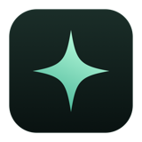

<p align="center"></p>
<h1 align="center">POLARIS</h1>
<p align="center"><strong>A space for your agents.</strong></p>
<p align="center">Codex 与 DeepSeek Harness 的原生 macOS 工作空间。</p>
<p align="center"><a href="https://github.com/Arika1415/Polaris-Releases/releases/download/v1.17.3/Polaris-1.17.3-106-arm64-release.dmg"></a></p>
<p align="center"><sub>1.17.3（106）预览版 · Apple Silicon · macOS 13.0+</sub></p>
<p align="center"><a href="docs/GETTING_STARTED.zh-CN.md">完整操作指南</a> · <a href="#quick-start">快速开始</a> · <a href="https://github.com/Arika1415/Polaris-Releases/releases/tag/v1.17.3">本版下载与更新说明</a> · <a href="#compatibility">支持范围</a></p>

Polaris brings your local agents, projects, conversations and handoffs into one native Mac workspace. Open it from the floating orb, follow the work, then fold it away while tasks continue.

通过悬浮球随时展开工作空间，在同一处管理项目、继续对话、查看执行过程，或把成果交给另一个 Agent。收起面板后，已运行的任务仍可继续。Polaris 连接你自己的本机 Agent 环境，账号和可用模型由对应 Agent 提供。

## Why Polaris · 产品特色

- **专注于当前项目。** 原生macOS全屏Space、纯黑阅读界面、轻字重与逐字渐入，保留历史、底部输入、模型选择和运行任务。原生全屏支持系统桌面切换；Polaris也可从程序坞正常退出。
- **两个 Agent，各自工作。** Codex 与 DSH 保持独立连接，可分别执行任务；会话和模型按品牌隔离。绿色与蓝色主题让当前 Agent 清晰可辨。
- **接棒带上成果。** 整理并审阅交接包，明确接收 Agent、项目和文件清单，复制并校验成果；接收方核对、用户确认后才继续并归档来源。
- **图片留在上下文中。** 输入区与消息缩略图、点击放大、缩放与历史查看；支持的生成结果保存在本机，保持原生输入和聊天排版。
- **原生输入，持续阅读。** 保留 macOS 文本编辑和输入法，查看流式回复、任务进度与工具过程；浏览历史时保持阅读位置，可选择跟随新消息。
- **项目与规则有边界。** 项目可改名、备注、归档和恢复；全局规则与项目补充规则明确确认，并保留消息对应的规则版本。
- **桌面上轻一点。** 悬浮球可拖动、贴边、悬停预览和点击恢复，面板按需展开。GitHub 在线更新负责下载、校验和安装。

Polaris 自身不向自有服务器上传聊天、项目或图片。通过 Agent 发送的内容仍会按该 Agent 的账号及服务配置处理；更新会访问公开 GitHub。你的历史、规则和图片保存在本机，安装包不包含开发者的账号或记录。

## Images, in context · 聊天图片

<p align="center"></p>
<p align="center"><a href="assets/polaris-chat-images.mp4">高画质视频 · 50fps MP4</a></p>

动图从桌面悬浮球展开聊天，展示样例图片缩略图、打开原生预览、跟随镜头查看细节，再返回球体。缩略图保留在聊天中，点击后可放大查看；输入区支持拖入图片文件。Codex 支持的图片生成结果及图片历史可以显示，Agent 最终回复中的明确本地 Markdown 图片引用也会展示。

图片生成取决于 Agent 的工具与账号能力。DSH 附件发送仍有限制；无法读取的图片会显示不可用，外部图片地址不会被自动联网加载。

## A handoff you can review · 可审阅的接棒

<p align="center"></p>
<p align="center"><a href="assets/polaris-handoff-files.mp4">高画质视频 · 50fps MP4</a></p>

动图连续展示准备、审阅、选择接收方与文件、交付、核对和确认后归档，并放大文件清单。当前 Agent 使用程序整合的对话和文件元数据，整理可编辑的交接包。你可以选择新项目或已有项目接管，审阅哪些文件随成果交付。新项目使用独立目录，已有项目收到独立子目录，不覆盖原文件。

复制文件不等于接管完成。接收方先核对，用户确认后程序再次校验成果，再继续工作、归档来源并保留来源关系。失败或送达不明时保留原项目，不自动重复发送。交接总结不是文件事实，归档也不是完整目录备份。

<sub>四张动图及配套视频以50fps输出，按模拟屏幕比例满幅制作，调整主体居中、镜头加减速与循环收束。均复用1.16.0原生UI与控制器连续录制，加入模拟桌面、编排指针和跟随镜头，不再用静态截图转场代替交互。Agent回复为固定样例；接棒复制、校验及确认后归档处理的是实际临时文件。它们不是生产项目或真实账号任务的录像，也不会录入你的桌面与聊天。见[演示来源](assets/README.md)。</sub>

## Stay within reach · 悬浮球交互

<p align="center"></p>
<p align="center"><a href="assets/polaris-drag.mp4">高画质视频 · 50fps MP4</a></p>

拖动悬浮球放到顺手的位置。靠近可用屏幕边缘时逐渐吸附，停留约0.55秒，边条快速闪烁表示可以松手贴边。悬停只高亮并轻微放大边条，点击恢复为球体，再次点击展开面板。

<p align="center"></p>
<p align="center"><a href="assets/polaris-expand.mp4">高画质视频 · 50fps MP4</a></p>

悬浮球交互动图使用样例工程和编排手势，镜头缩放便于看清操作；主要展示保留的展开、收起与拖动交互，聊天图片与成果接棒见上方动图；这些1.16.0素材尚未包含新专注模式。完整工程和真实任务不会被录入这些示例。

<a id="quick-start"></a>
## Quick start · 快速开始

1. 下载 [Polaris-1.17.3-106-arm64-release.dmg](https://github.com/Arika1415/Polaris-Releases/releases/download/v1.17.3/Polaris-1.17.3-106-arm64-release.dmg)，将应用复制到 Applications。不要把 Source code ZIP 当成安装包。
2. 安装并配置你选择的本机 Codex 或 DeepSeek Harness，完成该 Agent 自己的登录或服务配置。
3. 启动 Polaris，按首次部署引导检查环境、选择 Agent 并验证连接。
4. 点击悬浮球展开面板，选择工作目录、输入任务并发送。已有项目可在项目卡片或“全部记录”中继续。
5. 使用 `… → 切换 Agent` 选择另一 Agent；模型选择位于发送键旁。正在运行的另一个 Agent 任务不会因切换展示而被结束。

**第一次使用、图片、接棒、规则、归档、更新与常见问题：**[完整操作指南](docs/GETTING_STARTED.zh-CN.md)。

English: download the DMG, copy Polaris to Applications, configure a local Codex or DeepSeek Harness installation, then follow the setup guide. Open the orb, choose a workspace and send a task. Switch Agent from the `…` menu; choose its model beside Send. Accounts, models and tool availability belong to the selected Agent.

## Updated together · 与本机功能一致

1.16.0发布包含此前未公开的成果文件交付和聊天图片功能。公开DMG已通过无需GitHub登录的链接回下载，SHA-256与上传原件一致；本机应用副本经过相同的剔除调试符号和签名步骤后，39个文件与下载件完全一致。原始开发安装的调试符号／签名哈希可能不同，功能代码与运行资源一致。

真实镜像安装、精确回滚、公开更新API与下载校验，以及图片、成果交付和双语言检查已通过。不同电脑仍需配置自己的Agent、模型账号与macOS权限；这些本地状态不会随安装包分发。

<a id="compatibility"></a>
## Compatibility · 支持范围

| 平台／能力 | 当前状态 |
|---|---|
| macOS · Apple Silicon（M系列） | **1.17.3（106）公开预览**，最低编译目标macOS 13.0；13.6.7实机待验收 |
| macOS · Intel | 尚无已验收安装包 |
| Windows | 实验原型，尚未达到验收标准，不在本次公开包内 |
| Codex | 本机检测、会话、流式回复、执行过程、停止、模型选择、支持的图片与附件 |
| DeepSeek Harness | 检测、独立任务、流式回复、工具过程、停止、模型选择、Polaris本地历史续问；不导入桌面全部历史，附件仍有限制 |
| 签名与分发 | ad-hoc预览包，尚未完成Developer ID签名及Apple公证，下载后可能受Gatekeeper限制；不是App Store版本 |

本版无独立执行窗口或伴随应用；工具过程在聊天内显示。安装包只含主程序、更新器和必要运行资源，不含源码、测试、凭据或聊天记录。公开安装包不等于开源，本仓库不提供Polaris源码或开源授权。

## Install & update · 安装与更新

已有用户先保存任务、正常退出，再替换原安装位置。Polaris内可通过 `… → 更新与版本…` 检测、下载、校验和安装；正常退出重启后启用新版。取消退出不会让任务被强行终止。

1.10.43及更早版本需手动安装新版一次；升级后可继续在线更新。下载公开包不需要GitHub账号。

需要手动校验时，将DMG和[同名.sha256](https://github.com/Arika1415/Polaris-Releases/releases/download/v1.17.3/Polaris-1.17.3-106-arm64-release.dmg.sha256)放在同一目录执行：

```sh
shasum -a 256 -c Polaris-1.17.3-106-arm64-release.dmg.sha256
```

[本版发行说明](https://github.com/Arika1415/Polaris-Releases/releases/tag/v1.17.3) · [历史版本](https://github.com/Arika1415/Polaris-Releases/releases)
