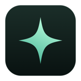
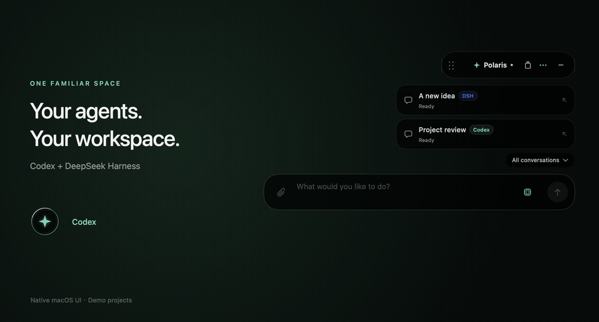
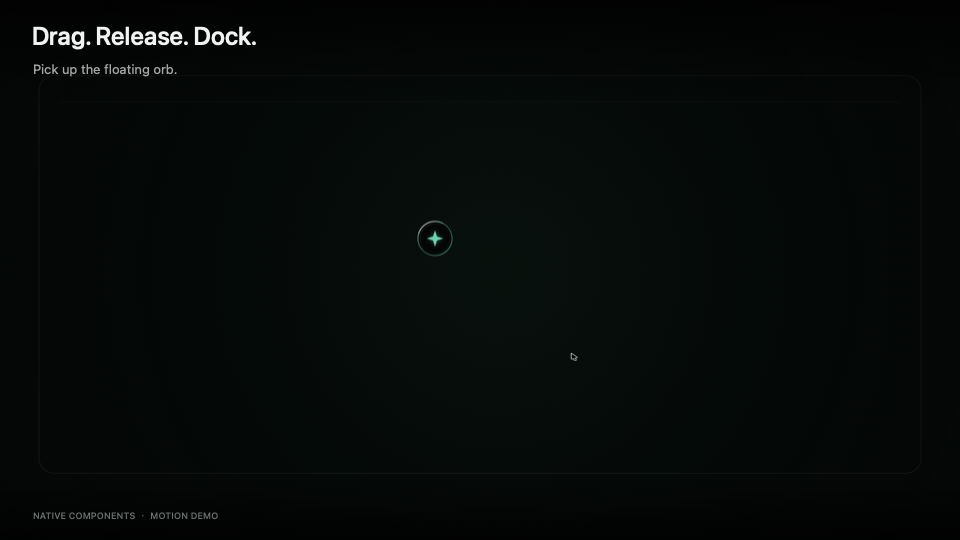
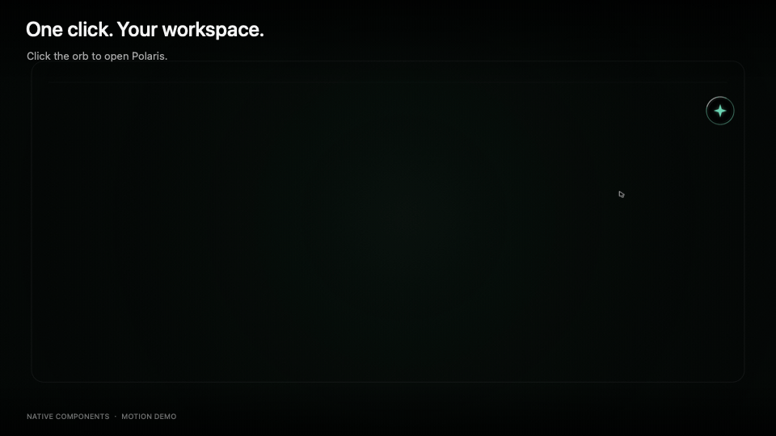

<p align="center">
  
</p>

<h1 align="center">POLARIS</h1>

<p align="center"><strong>A space for your agents.</strong></p>

<p align="center">A native macOS workspace for Codex and DeepSeek Harness.</p>

<p align="center">
  <a href="https://github.com/Arika1415/Polaris-Releases/releases/download/v1.10.44/Polaris-1.10.44-84-arm64-release.dmg"></a>
</p>

<p align="center">
  <a href="#installation">Installation / 安装说明</a> ·
  <a href="https://github.com/Arika1415/Polaris-Releases/releases">Release notes</a>
</p>

<p align="center"><sub>Apple Silicon preview · Requires a configured local Codex or DeepSeek Harness.</sub></p>

<p align="center">
  
</p>

<p align="center"><sub>Native macOS UI with demo projects. Agent capabilities vary; see the release notes.</sub></p>

<p align="center"><strong>One-click access</strong> · <strong>Session management</strong> · <strong>Visible task progress</strong></p>

## Place it where you work

Drag the floating orb to a comfortable position. Release it to dock at a side or near the top center, with a subtle destination hint and a gentle settling motion. The close-up follows the orb so you can see the press, drag, and release.

拖动悬浮球，放到顺手的位置；松开后自动吸附到边缘或顶部中央。镜头会跟随并拉近，展示拖动反馈与落点细节。

<p align="center">
  
</p>

## Your workspace, one click away

Click the orb to reveal your projects, conversations, and native input area. The camera moves closer to the input, then follows the panel back to the orb. Folding the panel keeps your running tasks going in the background.

点击悬浮球展开工作空间，查看项目、继续会话、输入任务。动图拉近输入区，再展示收起动作；实际任务在面板收起后仍可继续运行。

<p align="center">
  
</p>

<p align="center"><sub>Native Polaris components with sample projects and choreographed gestures. Camera zoom is added for clarity.</sub></p>

## A familiar flow for your agents

- **Keep projects in view.** Browse your recent sessions and return to their working context. Records retain their Agent ownership.
- **Follow the work.** See streamed replies, task progress, and tool activity as supported by the connected Agent. Stop a task when you need to take control.
- **Choose your Agent and model.** Switch between Codex and DeepSeek Harness in the same workspace. Green and blue themes make the active Agent visible; the model picker shows that Agent's available models.

项目记录、执行过程和 Agent 选择集中在同一个工作空间。不同 Agent 的功能范围有所区别，具体支持情况见下方版本说明。

---

## Polaris 下载

Polaris 是桌面 Agent 任务面板，提供悬浮球、会话管理及任务执行进度，目前适配本机 Codex 与 DeepSeek Harness。本仓库仅提供安装包与发行说明。

## 可下载版本

| 平台 | 当前状态 | 下载 |
|---|---|---|
| macOS · Apple Silicon（M 系列） | 1.10.44（84）预览版 | [版本说明与附件](https://github.com/Arika1415/Polaris-Releases/releases/tag/v1.10.44) |
| macOS · Intel | 尚无已验收安装包 | 暂未发布 |
| Windows | 开发中，尚未达到验收标准 | 暂未公开发布 |

本版移除独立执行窗口与伴随应用，安装包只含主程序与更新器；聊天内 Agent 工具执行、任务进度与停止功能继续保留。保留多轮输出稳定排版、原生输入框和按需加载历史。继续支持 DSH 历史续问、维护工具正确安装路径，以及 `… → 屏幕录制权限…` 入口。屏幕权限必须由用户在系统设置中允许；授权后若仍失败，请保存任务并正常退出重开。包仍为 ad-hoc 签名，无法保证更新后授权持续有效。

继续为项目提供 DSH / Codex 归属标记，切换到 DeepSeek Harness 时以 0.6 秒过渡为蓝色主题，切回 Codex 恢复绿色。面板与悬浮球同步使用主色，保留原生输入框及原有动效节奏。

继续支持 DeepSeek Harness 的检测、发送、流式回复、工具执行过程、停止和模型切换。入口为 `… → 切换 Agent → DeepSeek Harness`，模型仍在发送键旁选择。现支持在 Polaris 本地历史项目中恢复原生 DSH 会话并继续提问；恢复失败可重新检查，草稿和记录保留。暂不导入 Harness 桌面全部原生历史，附件与高级交互留待后续版本。已验证 Harness 0.2.1-rc.2；账号或 API Key 在 Harness 内配置。

继续支持 GitHub 在线更新：在 `… → 更新与版本…` 中检测新版，点击安装后自动下载、校验、替换并正常退出重启。保留发送键旁模型切换、滚动修复、中英文界面与原生输入框。支持按 Agent 品牌隔离模型和会话。

**1.10.43 及更早版本需手动安装 1.10.44 一次：旧在线安装器要求已移除的伴随组件，会拒绝新包。升级至本版后可继续在线更新。** 更新无需 GitHub 账号或开发工具；运行中的任务仍有退出确认，取消重启后可稍后启用新版。

<a id="installation"></a>

## Mac 安装

1. 在上面的版本页面下载 `Polaris-1.10.44-84-arm64-release.dmg`；不要将 GitHub 自动生成的 Source code ZIP 当成安装包。
2. 需要校验时，同时下载同名 `.sha256` 文件。
3. 打开 DMG，将应用复制到自己的 Applications 目录。已有旧版时保留原安装位置；先保存任务并正常退出旧版，再替换该位置的应用。
4. 安装并配置本机 Codex 或 DeepSeek Harness。Polaris 安装包不包含模型服务或订阅。

构建目标为 macOS 13.0 及以上、Apple Silicon（arm64）。macOS 13.6.7 已完成编译兼容检查，尚未在该系统实机验收；请按预览测试版使用。

## 分发说明

当前为预览包，使用 ad-hoc 本地签名，尚未完成 Apple Developer ID 签名和公证，可能被 Gatekeeper 拦截；不是 App Store 发行版。

发布安装包不等于开源。本仓库不提供 Polaris 源码或开源授权。包内保留必要的第三方运行资源和许可证，不包含开发源码、测试、账号凭据或聊天历史。

## 校验下载文件

将 DMG 和 `.sha256` 放到同一目录，在该目录执行：

```sh
shasum -a 256 -c Polaris-1.10.44-84-arm64-release.dmg.sha256
```

更多历史版本见 [Releases](https://github.com/Arika1415/Polaris-Releases/releases)。
